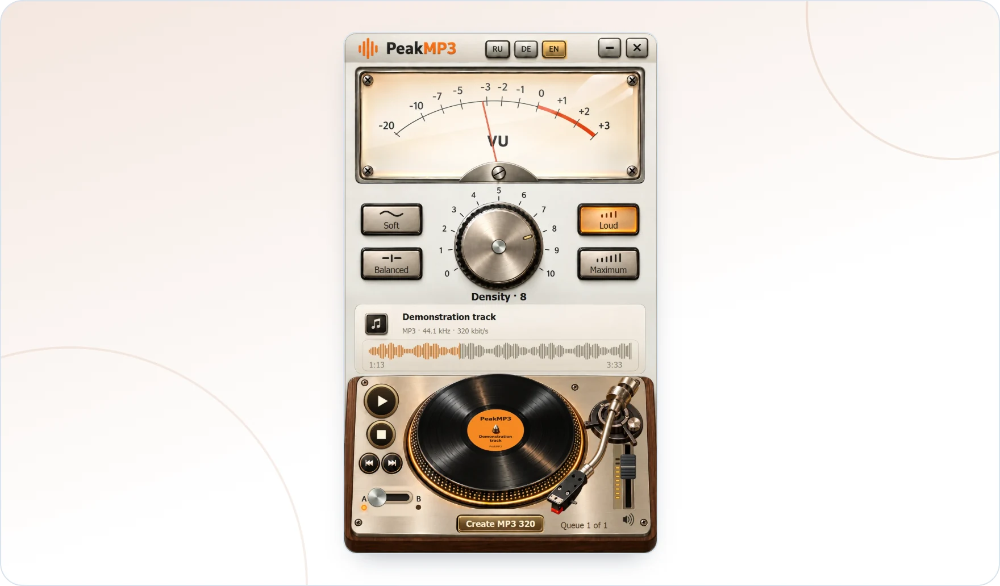

<!-- ppk-readme:head:start -->
<a href="https://popovantondev.github.io/PeakMP3/index-en.html"><picture><source media="(prefers-color-scheme: dark)" srcset="https://raw.githubusercontent.com/popovantondev/PeakMP3/main/docs/readme/header-en-dark.16cbe823.svg"></picture></a>
<!-- ppk-readme:head:end -->

# PeakMP3

[Русский](README.ru.md) · [Deutsch](README.md) · **English**

<!-- ppk-readme:body:start -->

<a href="https://github.com/popovantondev/YouTubeDownloader/releases/tag/v2.6.0"><picture><source media="(prefers-color-scheme: dark)" srcset="https://raw.githubusercontent.com/popovantondev/PeakMP3/main/docs/readme/btn-download-en-dark.9b5d9b8b.svg"></picture></a>
<a href="https://popovantondev.github.io/PeakMP3/index-en.html"><picture><source media="(prefers-color-scheme: dark)" srcset="https://raw.githubusercontent.com/popovantondev/PeakMP3/main/docs/readme/btn-website-en-dark.b422382a.svg"></picture></a>
<a href="https://popovantondev.github.io/PeakMP3/Guide-en.html"><picture><source media="(prefers-color-scheme: dark)" srcset="https://raw.githubusercontent.com/popovantondev/PeakMP3/main/docs/readme/btn-guide-en-dark.ae28b78e.svg"></picture></a>
<a href="https://popovantondev.github.io/PeakMP3/index-en.html#demo"><picture><source media="(prefers-color-scheme: dark)" srcset="https://raw.githubusercontent.com/popovantondev/PeakMP3/main/docs/readme/btn-demo-en-dark.c5a8f9e0.svg"></picture></a>
<a href="https://github.com/popovantondev/PeakMP3/issues/new"><picture><source media="(prefers-color-scheme: dark)" srcset="https://raw.githubusercontent.com/popovantondev/PeakMP3/main/docs/readme/btn-bug-en-dark.ccd973cf.svg"></picture></a>

<a href="https://raw.githubusercontent.com/popovantondev/PeakMP3/main/assets/site/peakmp3-en.webp"><picture><source media="(prefers-color-scheme: dark)" srcset="https://raw.githubusercontent.com/popovantondev/PeakMP3/main/docs/readme/preview-en-dark.e12777be.webp"></picture></a> 
<a href="https://raw.githubusercontent.com/popovantondev/PeakMP3/main/assets/site/peakmp3-en.webp">Full screenshot</a>

<picture><source media="(prefers-color-scheme: dark)" srcset="https://raw.githubusercontent.com/popovantondev/PeakMP3/main/docs/readme/divider-dark.2b821ace.svg"></picture>
<!-- ppk-readme:body:end -->

Vintage audio controls for Windows 7 SP1 x86 and newer Windows. Choose density, compare A/B, seek on the record and save MP3 320.

<!-- public-release:start -->
**PeakMP3 0.16.0 Preview**

[Download shared installer](https://github.com/popovantondev/YouTubeDownloader/releases/download/v2.6.0/YouTubeDownloader-PeakMP3-2.6.0-Preview-Setup.exe) · [Guide](https://popovantondev.github.io/PeakMP3/Guide-en.html) · [Website](https://popovantondev.github.io/PeakMP3/index-en.html)
<!-- public-release:end -->

This is the standalone PeakMP3 0.16.0 project.

## Why the installer is in the YouTubeDownloader release

PeakMP3 and YouTube Downloader are installed together by one shared installer. It is hosted in the [YouTubeDownloader 2.6.0 release](https://github.com/popovantondev/YouTubeDownloader/releases/tag/v2.6.0), so the download button of PeakMP3 leads there too. PeakMP3 has no release of its own; the published archives are unchanged.

The website has three licensed 24-second examples at prepared densities 0–10. It does not process visitors’ files. Music is CC BY 4.0; see [credits](music/CREDITS.md).

## Build

See [BUILD.md](BUILD.md) for the x86 CLR2 build.

## Rights

Published source is available for inspection under [RIGHTS.md](RIGHTS.md), not an open-source license. Third-party components and music have separate terms.
