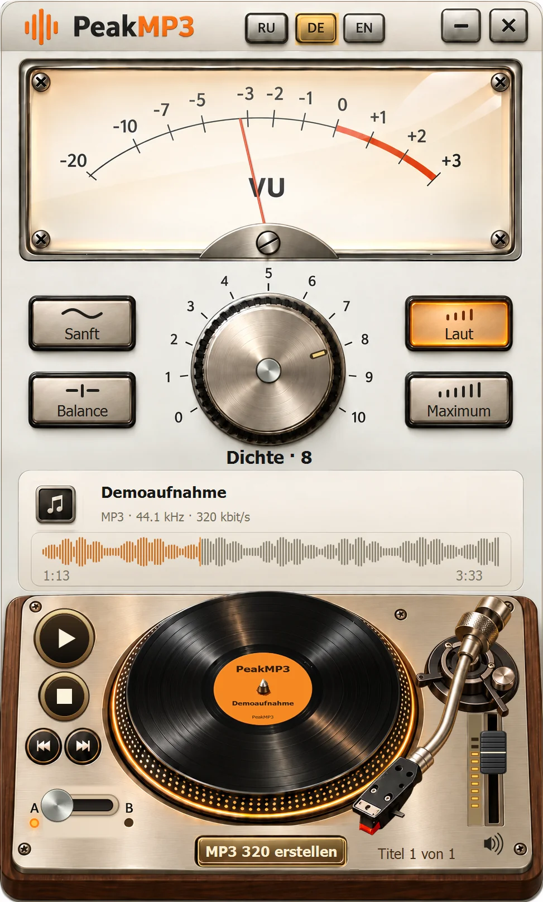

  

# PeakMP3

[Русский](README.ru.md) · **Deutsch** · [English](README.en.md)

Analoge Audiosteuerung für Windows 7 SP1 x86 und neuere Windows-Versionen. Dichte einstellen, A/B vergleichen, auf der Schallplatte springen und MP3 320 speichern.

<!-- public-release:start -->
**PeakMP3 0.16.0 Preview**

[Gemeinsames Setup herunterladen](https://github.com/popovantondev/YouTubeDownloader/releases/download/v2.6.0/YouTubeDownloader-PeakMP3-2.6.0-Preview-Setup.exe) · [Anleitung](https://popovantondev.github.io/PeakMP3/Guide-de.html) · [Website](https://popovantondev.github.io/PeakMP3/index.html)
<!-- public-release:end -->

**[Im Browser ausprobieren](https://popovantondev.github.io/PeakMP3/index.html#demo)** · **[Fehler melden](https://github.com/popovantondev/PeakMP3/issues/new)**

Dies ist das eigenständige Projekt PeakMP3 0.16.0.

## Warum das Setup bei YouTubeDownloader liegt

PeakMP3 und YouTube Downloader werden mit einem gemeinsamen Setup installiert. Dieses Setup liegt im [Release YouTubeDownloader 2.6.0](https://github.com/popovantondev/YouTubeDownloader/releases/tag/v2.6.0), deshalb führt auch der Download-Button von PeakMP3 dorthin. Ein eigenes PeakMP3-Release gibt es nicht; veröffentlichte Archive sind unverändert.

Die Website bietet drei lizenzierte 24-Sekunden-Ausschnitte mit vorbereiteten Stufen 0–10. Besucherdateien werden nicht im Browser verarbeitet. Musik: CC BY 4.0, siehe [Nachweise](music/CREDITS.md).

## Build

Der x86-CLR2-Build ist in [BUILD.md](BUILD.md) beschrieben.

## Rechte

Quellcode dient der Einsicht nach [RIGHTS.md](RIGHTS.md), ohne Open-Source-Lizenz. Drittanbieter und Musik haben eigene Bedingungen.
