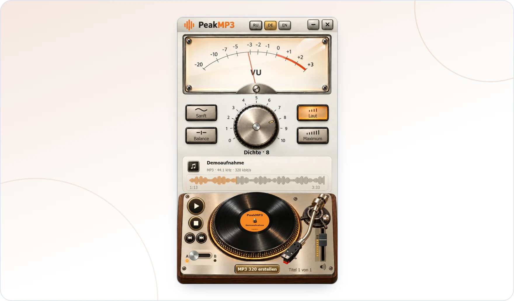

<!-- ppk-readme:head:start -->
<a href="https://popovantondev.github.io/PeakMP3/index.html"><picture><source media="(prefers-color-scheme: dark)" srcset="https://raw.githubusercontent.com/popovantondev/PeakMP3/main/docs/readme/header-de-dark.180243b9.svg"></picture></a>
<!-- ppk-readme:head:end -->

# PeakMP3

[Русский](README.ru.md) · **Deutsch** · [English](README.en.md)

<!-- ppk-readme:body:start -->

<a href="https://github.com/popovantondev/YouTubeDownloader/releases/tag/v2.6.0"><picture><source media="(prefers-color-scheme: dark)" srcset="https://raw.githubusercontent.com/popovantondev/PeakMP3/main/docs/readme/btn-download-de-dark.cadfa88b.svg"></picture></a>
<a href="https://popovantondev.github.io/PeakMP3/index.html"><picture><source media="(prefers-color-scheme: dark)" srcset="https://raw.githubusercontent.com/popovantondev/PeakMP3/main/docs/readme/btn-website-de-dark.cec116ef.svg"></picture></a>
<a href="https://popovantondev.github.io/PeakMP3/Guide-de.html"><picture><source media="(prefers-color-scheme: dark)" srcset="https://raw.githubusercontent.com/popovantondev/PeakMP3/main/docs/readme/btn-guide-de-dark.867af708.svg"></picture></a>
<a href="https://popovantondev.github.io/PeakMP3/index.html#demo"><picture><source media="(prefers-color-scheme: dark)" srcset="https://raw.githubusercontent.com/popovantondev/PeakMP3/main/docs/readme/btn-demo-de-dark.699f13d6.svg"></picture></a>
<a href="https://github.com/popovantondev/PeakMP3/issues/new"><picture><source media="(prefers-color-scheme: dark)" srcset="https://raw.githubusercontent.com/popovantondev/PeakMP3/main/docs/readme/btn-bug-de-dark.0e1d6756.svg"></picture></a>

<a href="https://raw.githubusercontent.com/popovantondev/PeakMP3/main/assets/site/peakmp3-de.webp"><picture><source media="(prefers-color-scheme: dark)" srcset="https://raw.githubusercontent.com/popovantondev/PeakMP3/main/docs/readme/preview-de-dark.44c230ef.webp"></picture></a> 
<a href="https://raw.githubusercontent.com/popovantondev/PeakMP3/main/assets/site/peakmp3-de.webp">Ganzer Screenshot</a>

<picture><source media="(prefers-color-scheme: dark)" srcset="https://raw.githubusercontent.com/popovantondev/PeakMP3/main/docs/readme/divider-dark.2b821ace.svg"></picture>
<!-- ppk-readme:body:end -->

Analoge Audiosteuerung für Windows 7 SP1 x86 und neuere Windows-Versionen. Dichte einstellen, A/B vergleichen, auf der Schallplatte springen und MP3 320 speichern.

<!-- public-release:start -->
**PeakMP3 0.16.0 Preview**

[Gemeinsames Setup herunterladen](https://github.com/popovantondev/YouTubeDownloader/releases/download/v2.6.0/YouTubeDownloader-PeakMP3-2.6.0-Preview-Setup.exe) · [Anleitung](https://popovantondev.github.io/PeakMP3/Guide-de.html) · [Website](https://popovantondev.github.io/PeakMP3/index.html)
<!-- public-release:end -->

Dies ist das eigenständige Projekt PeakMP3 0.16.0.

## Warum das Setup bei YouTubeDownloader liegt

PeakMP3 und YouTube Downloader werden mit einem gemeinsamen Setup installiert. Dieses Setup liegt im [Release YouTubeDownloader 2.6.0](https://github.com/popovantondev/YouTubeDownloader/releases/tag/v2.6.0), deshalb führt auch der Download-Button von PeakMP3 dorthin. Ein eigenes PeakMP3-Release gibt es nicht; veröffentlichte Archive sind unverändert.

Die Website bietet drei lizenzierte 24-Sekunden-Ausschnitte mit vorbereiteten Stufen 0–10. Besucherdateien werden nicht im Browser verarbeitet. Musik: CC BY 4.0, siehe [Nachweise](music/CREDITS.md).

## Build

Der x86-CLR2-Build ist in [BUILD.md](BUILD.md) beschrieben.

## Rechte

Quellcode dient der Einsicht nach [RIGHTS.md](RIGHTS.md), ohne Open-Source-Lizenz. Drittanbieter und Musik haben eigene Bedingungen.
