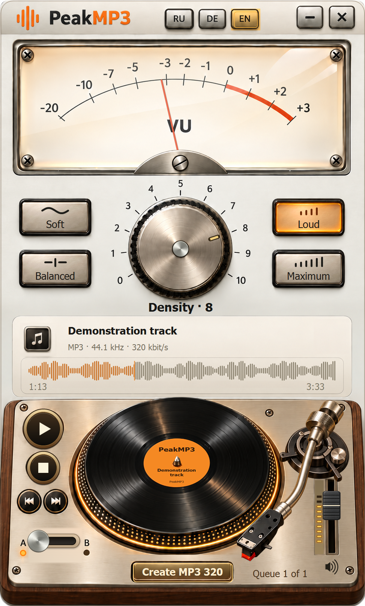

# PeakMP3

[English](README.md) · [Русский](docs/README.ru.md) · [Deutsch](docs/README.de.md)

Vintage audio controls for Windows 7 SP1 x86 and newer Windows. Choose density, compare A/B, seek on the record and save MP3 320.

<!-- public-release:start -->
**PeakMP3 0.16.0 Preview**

[Download shared installer](https://github.com/popovantondev/YouTubeDownloader/releases/download/v2.6.0/YouTubeDownloader-PeakMP3-2.6.0-Preview-Setup.exe) · [Guide](https://popovantondev.github.io/PeakMP3/Guide-en.html) · [Website](https://popovantondev.github.io/PeakMP3/index-en.html)
<!-- public-release:end -->

This repository is the development home of PeakMP3 0.16.0. The shared installer remains in YouTubeDownloader 2.6.0; its archives are unchanged.

The website has three licensed 24-second examples at prepared densities 0–10. It does not process visitors’ files. Music is CC BY 4.0; see [credits](music/CREDITS.md).

## Build

See [BUILD.md](BUILD.md) for the x86 CLR2 build. Published source is available for inspection under [RIGHTS.md](RIGHTS.md), not an open-source license. Third-party components and music have separate terms.
