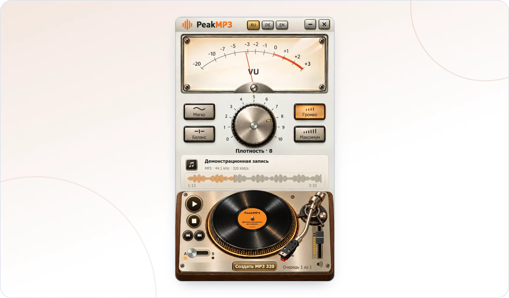

<!-- ppk-readme:head:start -->
<a href="https://popovantondev.github.io/PeakMP3/index-ru.html"><picture><source media="(prefers-color-scheme: dark)" srcset="https://raw.githubusercontent.com/popovantondev/PeakMP3/main/docs/readme/header-ru-dark.793e9e41.svg"></picture></a>
<!-- ppk-readme:head:end -->

# PeakMP3

**Русский** · [Deutsch](README.md) · [English](README.en.md)

<!-- ppk-readme:body:start -->

<a href="https://github.com/popovantondev/YouTubeDownloader/releases/tag/v2.6.0"><picture><source media="(prefers-color-scheme: dark)" srcset="https://raw.githubusercontent.com/popovantondev/PeakMP3/main/docs/readme/btn-download-ru-dark.05e7c287.svg"></picture></a>
<a href="https://popovantondev.github.io/PeakMP3/index-ru.html"><picture><source media="(prefers-color-scheme: dark)" srcset="https://raw.githubusercontent.com/popovantondev/PeakMP3/main/docs/readme/btn-website-ru-dark.06405aa4.svg"></picture></a>
<a href="https://popovantondev.github.io/PeakMP3/Guide-ru.html"><picture><source media="(prefers-color-scheme: dark)" srcset="https://raw.githubusercontent.com/popovantondev/PeakMP3/main/docs/readme/btn-guide-ru-dark.5c7e4f88.svg"></picture></a>
<a href="https://popovantondev.github.io/PeakMP3/index-ru.html#demo"><picture><source media="(prefers-color-scheme: dark)" srcset="https://raw.githubusercontent.com/popovantondev/PeakMP3/main/docs/readme/btn-demo-ru-dark.17427da6.svg"></picture></a>
<a href="https://github.com/popovantondev/PeakMP3/issues/new"><picture><source media="(prefers-color-scheme: dark)" srcset="https://raw.githubusercontent.com/popovantondev/PeakMP3/main/docs/readme/btn-bug-ru-dark.5cb1b75b.svg"></picture></a>

<a href="https://raw.githubusercontent.com/popovantondev/PeakMP3/main/assets/site/peakmp3-ru.webp"><picture><source media="(prefers-color-scheme: dark)" srcset="https://raw.githubusercontent.com/popovantondev/PeakMP3/main/docs/readme/preview-ru-dark.9f2aeeeb.webp"></picture></a> 
<a href="https://raw.githubusercontent.com/popovantondev/PeakMP3/main/assets/site/peakmp3-ru.webp">Снимок целиком</a>

<picture><source media="(prefers-color-scheme: dark)" srcset="https://raw.githubusercontent.com/popovantondev/PeakMP3/main/docs/readme/divider-dark.2b821ace.svg"></picture>
<!-- ppk-readme:body:end -->

Аналоговое управление звуком для Windows 7 SP1 x86 и более новых Windows. Плотность, сравнение A/B, перемотка по пластинке и сохранение MP3 320.

<!-- public-release:start -->
**PeakMP3 0.16.0 Preview**

[Скачать общий установщик](https://github.com/popovantondev/YouTubeDownloader/releases/download/v2.6.0/YouTubeDownloader-PeakMP3-2.6.0-Preview-Setup.exe) · [Инструкция](https://popovantondev.github.io/PeakMP3/Guide-ru.html) · [Сайт](https://popovantondev.github.io/PeakMP3/index-ru.html)
<!-- public-release:end -->

Здесь находится самостоятельный проект PeakMP3 0.16.0.

## Почему установщик лежит в выпуске YouTubeDownloader

PeakMP3 и YouTube Downloader ставятся одним общим установщиком. Он размещён в [выпуске YouTubeDownloader 2.6.0](https://github.com/popovantondev/YouTubeDownloader/releases/tag/v2.6.0), поэтому кнопка загрузки PeakMP3 ведёт туда же. Отдельного выпуска у PeakMP3 нет; опубликованные архивы не изменены.

На сайте доступны три лицензированных фрагмента по 24 секунды с готовыми плотностями 0–10. Файлы посетителей в браузере не обрабатываются. Музыка — CC BY 4.0: [авторы и изменения](music/CREDITS.md).

## Сборка

Сборка x86 CLR2 описана в [BUILD.md](BUILD.md).

## Права

Исходники доступны для ознакомления на условиях [RIGHTS.md](RIGHTS.md), не под открытой лицензией. Сторонние компоненты и музыка имеют отдельные условия.
