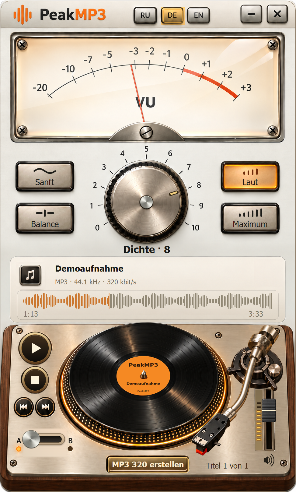

# PeakMP3

[English](../README.md) · [Русский](README.ru.md) · [Deutsch](README.de.md)

Analoge Audiosteuerung für Windows 7 SP1 x86 und neuere Windows-Versionen. Dichte einstellen, A/B vergleichen, auf der Schallplatte springen und MP3 320 speichern.

<!-- public-release:start -->
**PeakMP3 0.16.0 Preview**

[Download shared installer](https://github.com/popovantondev/YouTubeDownloader/releases/download/v2.6.0/YouTubeDownloader-PeakMP3-2.6.0-Preview-Setup.exe) · [Guide](https://popovantondev.github.io/PeakMP3/Guide-de.html) · [Website](https://popovantondev.github.io/PeakMP3/index-de.html)
<!-- public-release:end -->

Dies ist das eigenständige Projekt PeakMP3 0.16.0. Das gemeinsame Setup bleibt im Release YouTubeDownloader 2.6.0; veröffentlichte Archive sind unverändert.

Die Website bietet drei lizenzierte 24-Sekunden-Ausschnitte mit vorbereiteten Stufen 0–10. Besucherdateien werden nicht im Browser verarbeitet. Musik: CC BY 4.0, siehe [Nachweise](../music/CREDITS.md).

## Build

Der x86-CLR2-Build ist in [BUILD.md](../BUILD.md) beschrieben. Quellcode dient der Einsicht nach [RIGHTS.md](../RIGHTS.md), ohne Open-Source-Lizenz. Drittanbieter und Musik haben eigene Bedingungen.
