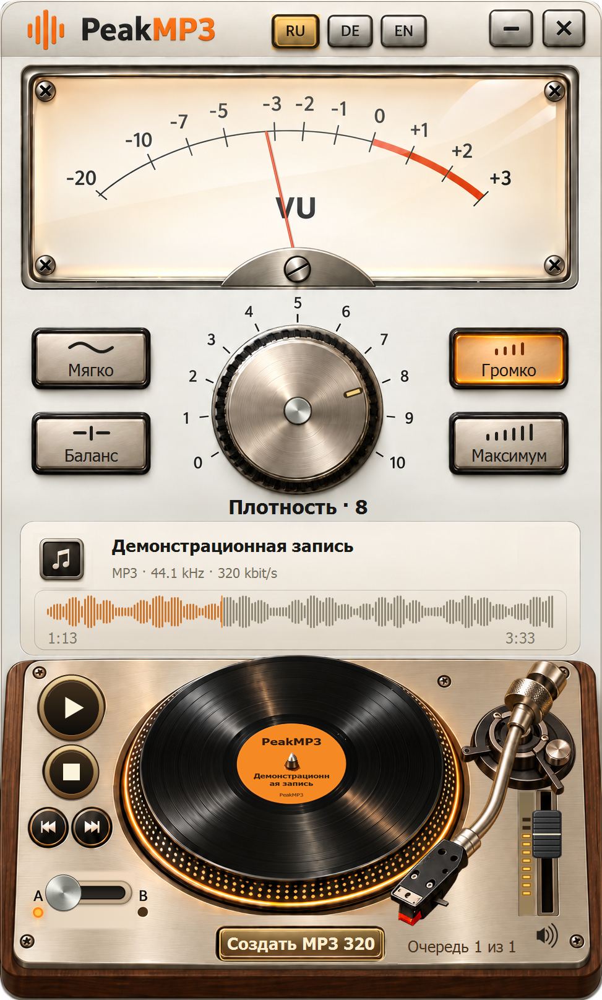

# PeakMP3

[English](../README.md) · [Русский](README.ru.md) · [Deutsch](README.de.md)

Аналоговое управление звуком для Windows 7 SP1 x86 и более новых Windows. Плотность, сравнение A/B, перемотка по пластинке и сохранение MP3 320.

<!-- public-release:start -->
**PeakMP3 0.16.0 Preview**

[Download shared installer](https://github.com/popovantondev/YouTubeDownloader/releases/download/v2.6.0/YouTubeDownloader-PeakMP3-2.6.0-Preview-Setup.exe) · [Guide](https://popovantondev.github.io/PeakMP3/Guide-ru.html) · [Website](https://popovantondev.github.io/PeakMP3/index-ru.html)
<!-- public-release:end -->

Здесь находится самостоятельный проект PeakMP3 0.16.0. Общий установщик остаётся в выпуске YouTubeDownloader 2.6.0; опубликованные архивы не изменены.

На сайте доступны три лицензированных фрагмента по 24 секунды с готовыми плотностями 0–10. Файлы посетителей в браузере не обрабатываются. Музыка — CC BY 4.0: [авторы и изменения](../music/CREDITS.md).

## Сборка

Сборка x86 CLR2 описана в [BUILD.md](../BUILD.md). Исходники доступны для ознакомления на условиях [RIGHTS.md](../RIGHTS.md), не под открытой лицензией. Сторонние компоненты и музыка имеют отдельные условия.
